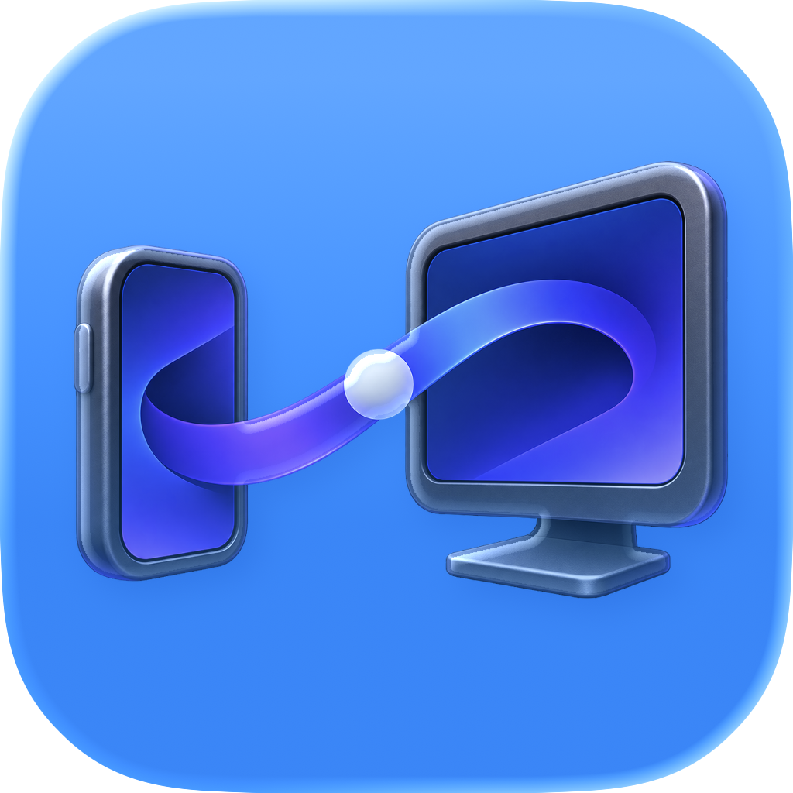
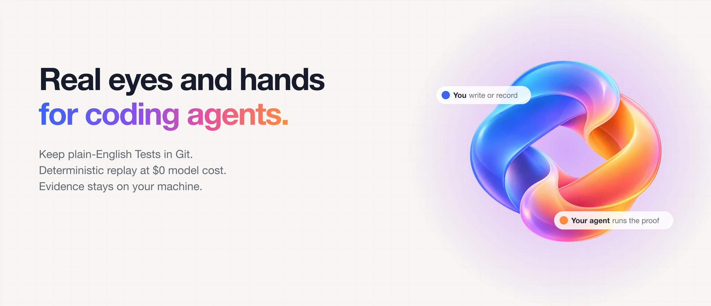
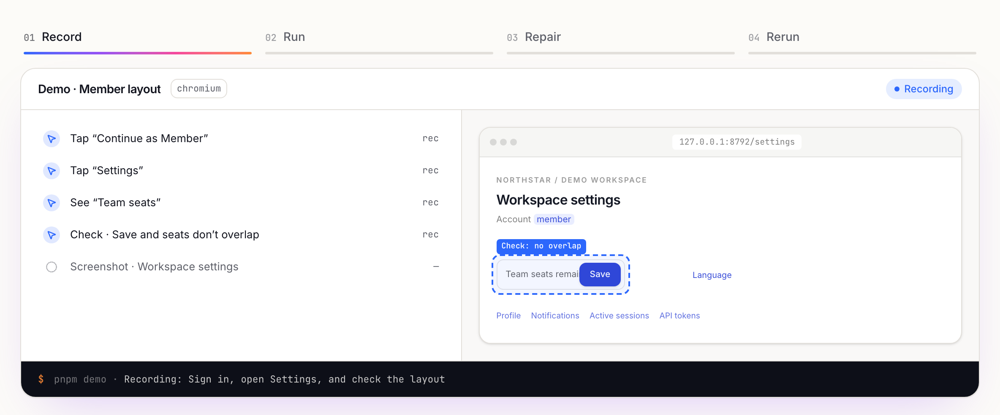
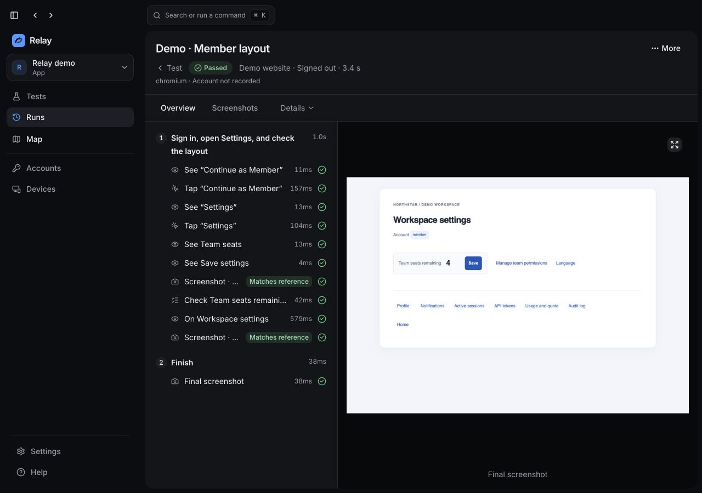
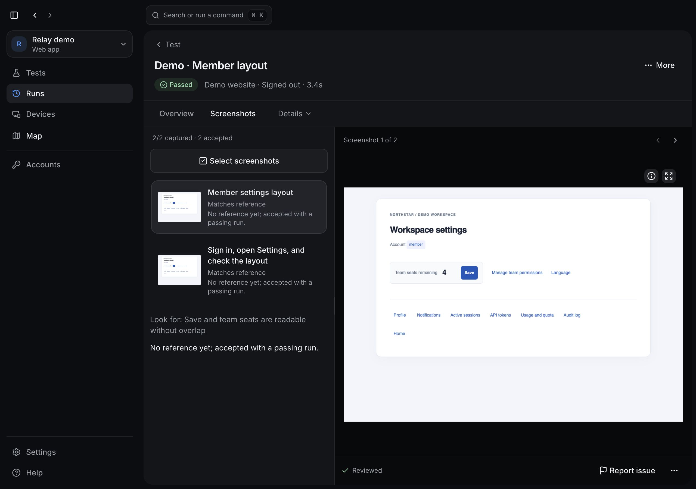
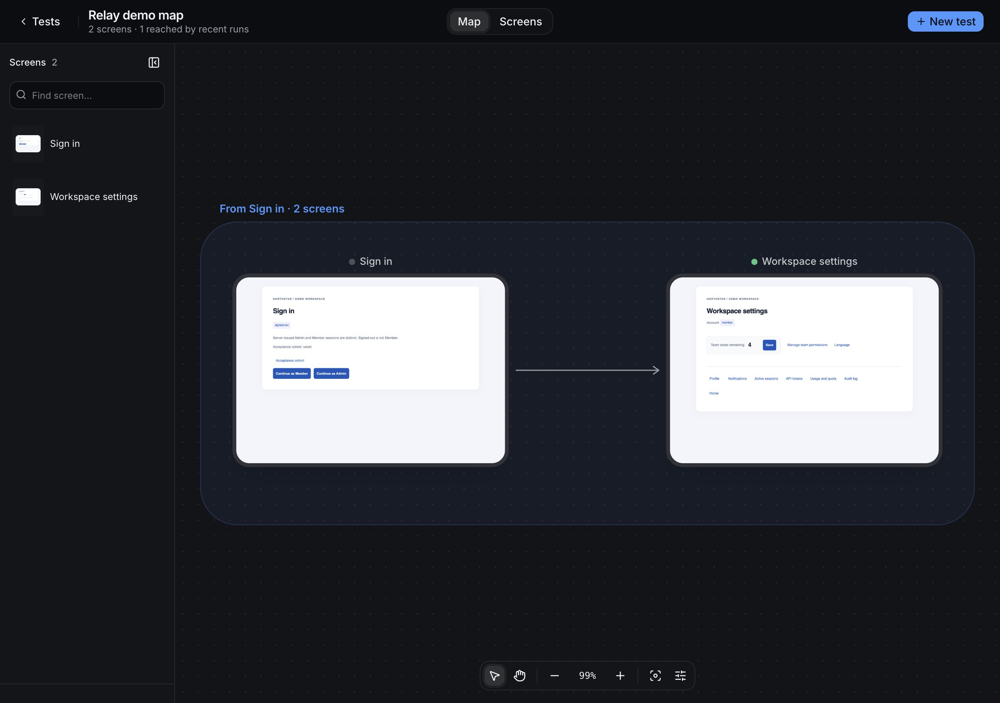

<div align="center">



# Relay

**Local verification for coding agents.**<br />
Give Claude Code, Cursor, and Codex eyes and hands on web, Android, and iOS. Keep Tests in Git as plain-English YAML; recorded interactions replay deterministically at $0 model cost.

<p>
  <a href="./LICENSE"></a>
  
  
  
</p>

<p>
  <a href="https://relay-lime-pi.vercel.app"><strong>Website</strong></a> ·
  <a href="https://relay-lime-pi.vercel.app/docs">Documentation</a> ·
  <a href="#quick-start"><strong>Quick start</strong></a> ·
  <a href="#how-it-works">How it works</a> ·
  <a href="#for-coding-agents">For agents</a> ·
  <a href="#platforms">Platforms</a> ·
  <a href="https://relay-lime-pi.vercel.app/docs/getting-started/first-test">Your first test</a>
</p>

<picture>
  <source media="(prefers-color-scheme: dark)" srcset="./packages/site/public/images/readme-banner-dark.webp" />
  
</picture>

</div>

## Catch a bug. Prove the fix.

Your agent changes checkout. When the change slides **Pay now** over the order total, the saved
Test fails and shows the screen. Fix the stylesheet, and the **same Test** proves the repair.

<picture>
  <source media="(prefers-color-scheme: dark)" srcset="./assets/readme/demo-dark.webp" />
  
</picture>

## Quick start

### Easy path: npx + MCP

You need **Node.js 24+** and Chrome, Chromium, or Edge for browser verification. No clone, no
Relay account, and no metered cloud devices.

```bash
npx -y @relay/cli
```

Once the local workspace is running, connect Claude Code with one line:

```bash
claude mcp add relay -- npx -y @relay/mcp
```

Cursor and Codex can launch the same `npx -y @relay/mcp` command through their MCP settings.
Choose **New test**, enter your website's address, and write or record one flow. The
[first-test guide](https://relay-lime-pi.vercel.app/docs/getting-started/first-test) walks through
it. Recorded steps do not need a model key; plain-English drafting and model-assisted actions do.

### Build from source (contributors and advanced setups)

You need **Node.js 24+**, **pnpm**, the **Vite+ CLI** (`vp`), Git, and Chrome, Chromium, or Edge.

```bash
git clone https://github.com/bernaferrari/relay.git
cd relay
pnpm run agent-device:install   # initialize the pinned device-runtime submodule and apply Relay's patch
pnpm run agent-device:build     # compile it (typecheck and tests consume its dist)
vp install
pnpm doctor -- --web
pnpm ensure:serve
pnpm dev:web       # or pnpm dev:desktop for the desktop app
```

The source checkout is the contributor path: use it to develop Relay itself, inspect internals, or
pin a specific revision.

## How it works

### 1 · Write or record

Choose **New test**, pick a website or a phone, and use your app. Taps, typing, and screens
become steps you can read and edit. Add a check for whatever has to stay true. Recorded interactions
replay exactly, without a model.

Prefer to write it? Author the Test as plain-English YAML in Git, or write _"Creating an API key
shows it in the list"_ and let Relay draft the steps. Description-based steps use a model unless
their interactions have been recorded or otherwise made exact: add an
[OpenRouter](https://openrouter.ai) key in **Settings → Advanced**, or set `OPENROUTER_API_KEY`.

### 2 · Run

Run the saved Test on your local browser, an Android phone or emulator, or an iPhone or
simulator. Each step shows what happened and how long it took. When a check fails, Relay says
what it **expected** and what it **saw**, next to the screenshot.

<a href="./assets/readme/app-run.webp">

</a>

### 3 · Review

Every Run keeps lightweight evidence: screenshots, screen structure, an action timeline, and
diagnostics, with video when motion matters. Accept what looks right, flag what doesn't, and
the decision stays with the Run.

<a href="./assets/readme/app-review.webp">

</a>

### 4 · Map

The Map keeps the screens you reached and the paths between them. Open a screen to inspect it,
rename it, or use a known path in your next Test.

<a href="./assets/readme/app-map.webp">

</a>

## For coding agents

Claude Code, Cursor, and Codex can drive the same Apps, Tests, and Runs through the CLI or MCP.
An agent can rerun a flow, read the verdict, fix the cause, and run it again. Then you review the
exact Run it made.

**CLI:** use the package directly, with no source checkout:

```bash
npx -y @relay/cli run "Checkout" --device browser        # rerun a saved Test
npx -y @relay/cli inspect <run-id>                      # expected vs saw, step by step
npx -y @relay/cli ci shop --output result.json --junit junit.xml
npx -y @relay/cli guide                                  # bundled guides, no server needed
```

From a source checkout, the same commands are available as `pnpm relay`. Add `--json` for machine
output. Exit codes are designed for loops:

| Code | Meaning                                                |
| ---- | ------------------------------------------------------ |
| `0`  | Passed                                                 |
| `1`  | A Test failed: the app didn't do what the Test expects |
| `3`  | Couldn't run: device, sign-in, or setup blocked it     |
| `10` | Passed, with screenshots waiting for review            |

`npx -y @relay/cli --help` lists every code.

**MCP:** connect Claude Code with one line:

```bash
claude mcp add relay -- npx -y @relay/mcp
```

For a host that accepts `mcpServers` JSON, launch the same package:

```json
{
  "mcpServers": {
    "relay": {
      "command": "npx",
      "args": ["-y", "@relay/mcp", "--profile", "qa"]
    }
  }
}
```

The `qa` profile covers the everyday loop: `relay_create_test`, `relay_run_test`,
`relay_get_verdict`, `relay_check_change`, and `relay_inspect_failure`. `device` adds live control
and recording, and `full` adds advanced raw operations. See the [MCP server](./packages/mcp/README.md)
and the [agent plugin and skills](./plugins/relay-proof/README.md). When developing the connector
from source, build it with `pnpm --filter @relay/mcp build` and point the host at
`packages/mcp/dist/relay-mcp.js` instead.

## Platforms

| Target                           | What you need             | Guide                                                       |
| -------------------------------- | ------------------------- | ----------------------------------------------------------- |
| **Websites**                     | Chrome, Chromium, or Edge | [Browser](./packages/site/content/docs/devices/browser.mdx) |
| **Android** phones and emulators | `adb`                     | [Android](./packages/site/content/docs/devices/android.mdx) |
| **iPhone and iPad**, simulators  | A Mac with Xcode          | [iOS](./packages/site/content/docs/devices/ios.mdx)         |

In a source checkout, `pnpm doctor` reports anything missing for the targets you want.

## Why Relay

- **Git-native Tests.** Plain-English YAML is small enough for people and agents to write, review,
  and diff.
- **Deterministic replay.** Recorded interactions replay without a model, so repeating a verified
  flow costs $0 in model usage.
- **Evidence, not vibes.** Every step keeps the screen it reached, so a pass or a fail comes with
  proof you can look at.
- **Local first.** Tests, Runs, and screenshots stay in your workspace. Model-assisted steps send
  only what they need to the provider you choose.
  [Evidence & privacy](./packages/site/content/docs/reference/evidence.mdx)
- **Built for agents.** Honest exit codes, expected-vs-saw verdicts, fail-closed safety, and an MCP
  doctor that checks the connection before any device input.
- **Open source.** MIT licensed. Read it, change it, and run it yourself.

## Learn more

- [Your first test](./packages/site/content/docs/getting-started/first-test.mdx): record one flow in your own website.
- [Record a flow](./packages/site/content/docs/workflows/recording.mdx): record and edit a Test in
  your own app.
- [The Map](./packages/site/content/docs/workflows/map.mdx): how Runs grow it, and how to fix a screen it got wrong.
- [Plans and Data sets](./packages/site/content/docs/workflows/data-sets.mdx): run Tests together across inputs, languages, or devices.
- [Packaged runtime](./packages/runtime/README.md): run Relay from a local tarball.

## Contributing

Relay is in active development, and device support varies by platform. Issues and pull requests
are welcome.

```bash
vp check          # formatting and lint
pnpm typecheck    # type checks
pnpm test         # tests
pnpm dev:site     # the landing page and docs
```

`pnpm test:coverage` writes LCOV reports; CI requires at least 70% line coverage on changed
source. The website and guides live in
[packages/site](./packages/site/README.md).

## License

[MIT](./LICENSE) © Bernardo Ferrari
