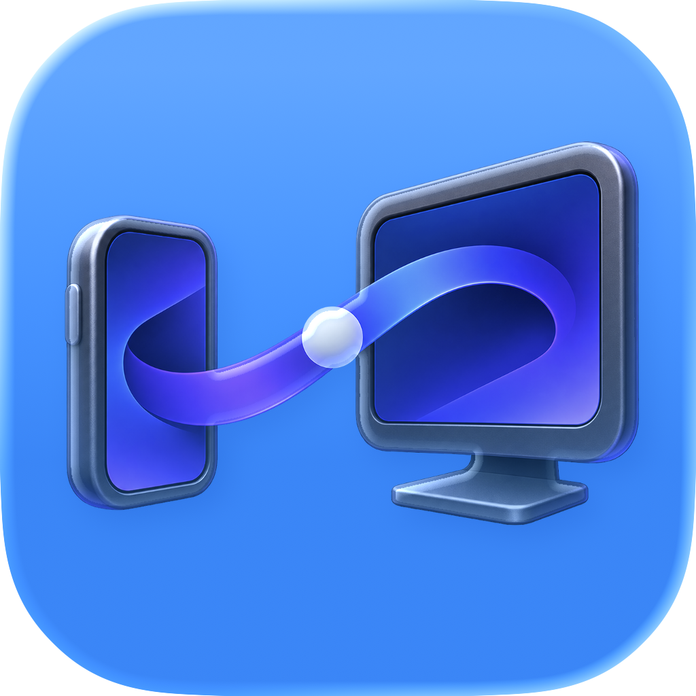
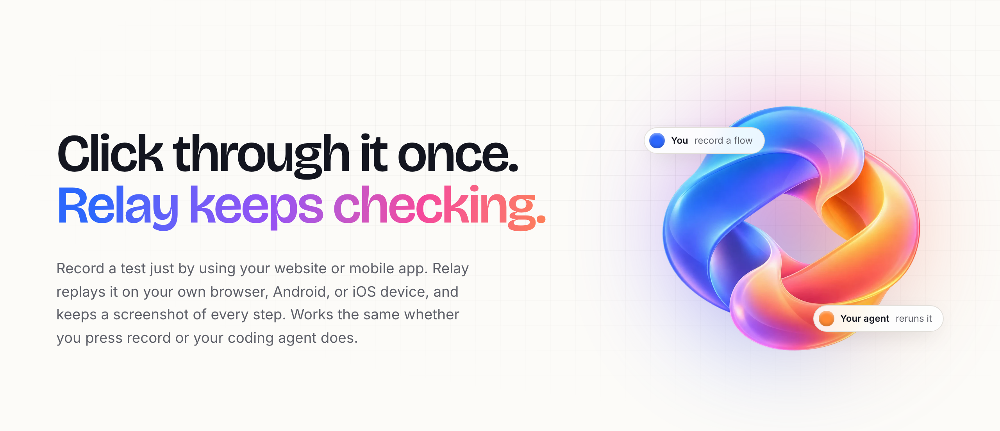
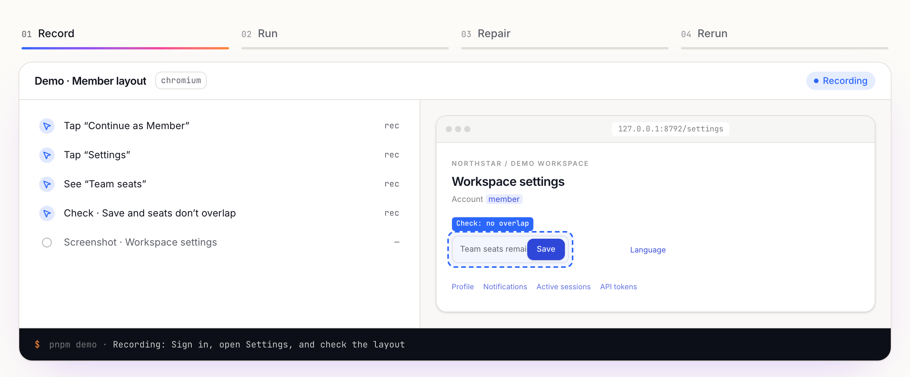
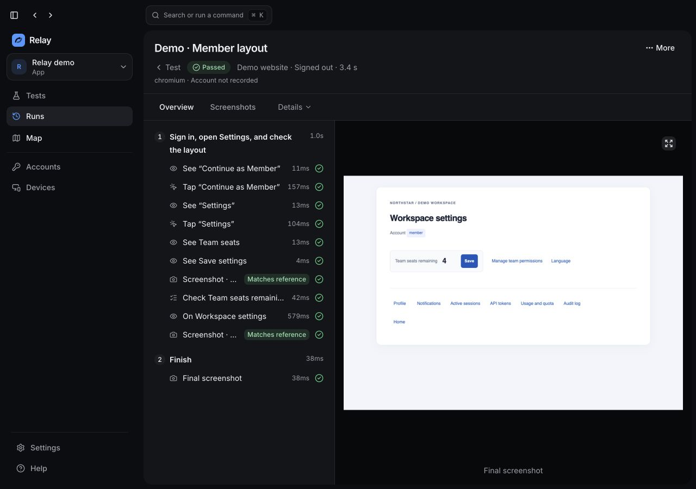
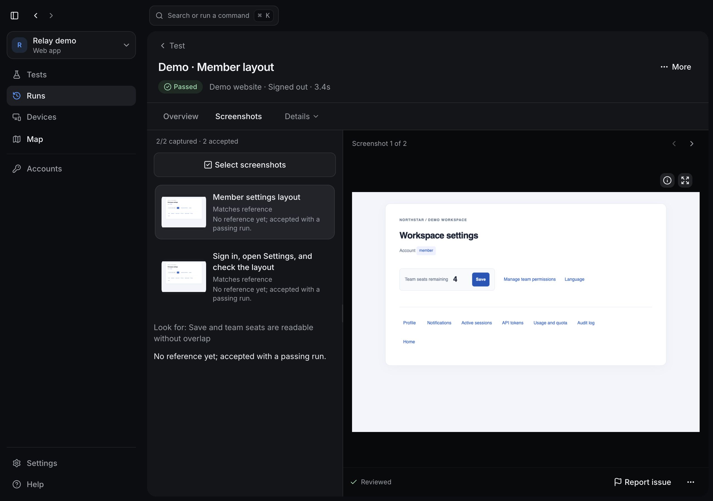
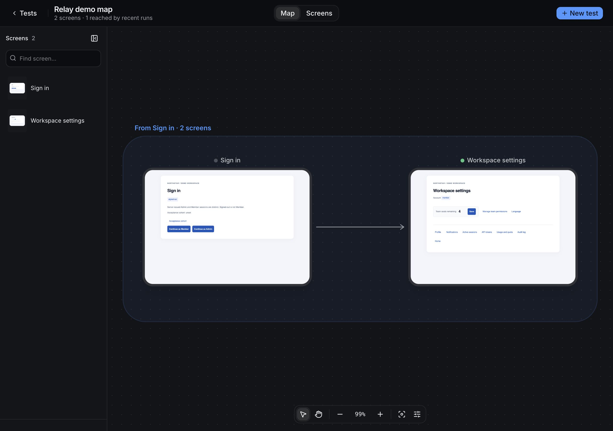

<div align="center">



# Relay

**Local QA for people and coding agents.**<br />
Click through your app once. Relay replays it on web, Android, and iOS, and shows you every screen.

<p>
  <a href="./LICENSE"></a>
  
  
  
</p>

<p>
  <a href="https://relay-lime-pi.vercel.app"><strong>Website</strong></a> ·
  <a href="https://relay-lime-pi.vercel.app/docs">Documentation</a> ·
  <a href="#quick-start"><strong>Quick start</strong></a> ·
  <a href="#how-it-works">How it works</a> ·
  <a href="#for-coding-agents">For agents</a> ·
  <a href="#platforms">Platforms</a> ·
  <a href="https://relay-lime-pi.vercel.app/docs/getting-started/first-test">Your first test</a>
</p>

<picture>
  <source media="(prefers-color-scheme: dark)" srcset="./assets/readme/banner-dark.webp" />
  
</picture>

</div>

## Catch a bug. Prove the repair.

The demo website ships with a real layout bug: the **Save** button covers the team-seats count.
Relay records a check, catches the overlap, the site is repaired, and the **same saved test**
runs again to prove it.

<picture>
  <source media="(prefers-color-scheme: dark)" srcset="./assets/readme/demo-dark.webp" />
  
</picture>

Run it yourself from a fresh clone. It needs no account and no model key.

## Quick start

You need **Node.js 24+**, **pnpm**, the **Vite+ CLI** (`vp`), and Chrome, Chromium, or Edge.

```bash
git clone https://github.com/bernaferrari/relay.git
cd relay
vp install
pnpm doctor -- --web
pnpm ensure:serve
pnpm demo
```

The demo prints links to both runs: the failure, with Save overlapping the seats, and the passing
rerun. The [first-test guide](https://relay-lime-pi.vercel.app/docs/getting-started/first-test) walks through every line of output.

Then open the workspace and record a test in your own app:

```bash
pnpm dev:desktop   # the desktop app
pnpm dev:web       # or the same workspace in your browser
```

## How it works

### 1 · Record

Choose **New test**, pick a website or a phone, and use your app. Taps, typing, and screens
become steps you can read and edit. Add a check for whatever has to stay true. Recorded steps
replay exactly, without a model.

Prefer to describe it? Write _"Creating an API key shows it in the list"_ and Relay drafts the
steps. That path uses a model: add an [OpenRouter](https://openrouter.ai) key in
**Settings → Advanced**, or set `OPENROUTER_API_KEY`.

### 2 · Replay

Run the saved test on your local browser, an Android phone or emulator, or an iPhone or
simulator. Each step shows what happened and how long it took. When a check fails, Relay says
what it **expected** and what it **saw**, next to the screenshot.



### 3 · Review

Every run keeps lightweight evidence: screenshots, screen structure, an action timeline, and
diagnostics, with video when motion matters. Accept what looks right, flag what doesn't, and
the decision stays with the run.



### 4 · Explore

The Map keeps the screens you reached and the paths between them. Open a screen to inspect it,
rename it, or use a known path in your next test.



## For coding agents

Your agent gets the same buttons you do. The app, the CLI, and MCP drive the same saved tests
and the same runs, so an agent can rerun a flow, read the verdict, fix the cause, and run it
again. Then you review the exact run it made.

**CLI:** from a source checkout, use `./bin/relay`.

```bash
./bin/relay run "Member layout" --device browser   # rerun a saved test
./bin/relay inspect <run-id>                      # expected vs saw, step by step
./bin/relay ci shop.example.com --output result.json --junit junit.xml
./bin/relay guide                                  # bundled guides, no server needed
```

Add `--json` for machine output. Exit codes are designed for loops:

| Code | Meaning                                                |
| ---- | ------------------------------------------------------ |
| `0`  | Passed                                                 |
| `1`  | A test failed: the app didn't do what the test expects |
| `3`  | Couldn't run: device, sign-in, or setup blocked it     |
| `10` | Passed, with screenshots waiting for review            |

`./bin/relay --help` lists every code.

**MCP:** build the connector with `pnpm --filter @relay/mcp build`, then add it to your agent host:

```json
{
  "mcpServers": {
    "relay": {
      "command": "node",
      "args": [
        "/absolute/path/to/relay/packages/mcp/dist/relay-mcp.js",
        "--server",
        "http://127.0.0.1:8787",
        "--credential-source",
        "none",
        "--profile",
        "qa"
      ]
    }
  }
}
```

The `qa` profile covers the everyday loop: `relay_create_test`, `relay_run_test`,
`relay_get_verdict`, `relay_check_change`, and `relay_inspect_failure`. `device` adds live control
and recording, and `full` exposes every operation. See the [MCP server](./packages/mcp/README.md)
and the [agent plugin and skills](./plugins/relay-proof/README.md).

## Platforms

| Target                           | What you need             | Guide                                                       |
| -------------------------------- | ------------------------- | ----------------------------------------------------------- |
| **Websites**                     | Chrome, Chromium, or Edge | [Browser](./packages/site/content/docs/devices/browser.mdx) |
| **Android** phones and emulators | `adb`                     | [Android](./packages/site/content/docs/devices/android.mdx) |
| **iPhone and iPad**, simulators  | A Mac with Xcode          | [iOS](./packages/site/content/docs/devices/ios.mdx)         |

`pnpm doctor` reports anything missing for the targets you want.

## Why Relay

- **Show, don't script.** A test starts as something you did, not code you wrote. Recorded steps
  replay without a model.
- **Evidence, not vibes.** Every step keeps the screen it reached, so a pass or a fail comes with
  proof you can look at.
- **Local first.** Tests, runs, and screenshots stay in your workspace. Model-assisted steps send
  only what they need to the provider you choose.
  [Evidence & privacy](./packages/site/content/docs/reference/evidence.mdx)
- **Built for agents.** Honest exit codes, expected-vs-saw verdicts, and an MCP doctor that checks
  the connection before any device input.
- **Open source.** MIT licensed. Read it, change it, and run it from source today.

## Learn more

- [Your first test](./docs/FIRST_TEST.md): the demo, step by step.
- [Record a flow](./packages/site/content/docs/workflows/recording.mdx): record and edit a test in
  your own app.
- [The Map](./docs/MAP.md): how runs grow it, and how to fix a screen it got wrong.
- [Plans and Data sets](./docs/PLANS.md): run tests together across inputs, languages, or devices.
- [Packaged runtime](./packages/runtime/README.md): run Relay from a local tarball.

## Contributing

Relay is in active development, and device support varies by platform. Issues and pull requests
are welcome.

```bash
vp check          # formatting and lint
pnpm typecheck    # type checks
pnpm test         # tests
pnpm dev:site     # the landing page and docs
```

`pnpm test:coverage` writes LCOV reports; CI requires at least 70% line coverage on changed
source. The [product contract](./PRODUCT_CONTRACT.md) defines the public routes, vocabulary, and
interaction rules checked in CI. The website and guides live in
[packages/site](./packages/site/README.md).

## License

[MIT](./LICENSE) © Bernardo Ferrari
